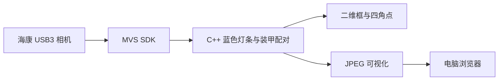

# RDK S100 蓝色装甲板识别

面向 RoboMaster 机甲竞赛视觉开发的蓝色装甲灯条检测项目。支持地平线 RDK S100 和 Ubuntu ROS 2 电脑，输出检测可视化、二维装甲框及四个像素角点，不包含射击、云台或运动控制。

核心算法来自 `rmcs_auto_aim_v2` 的电脑端实现，并已适配海康 MV-CS016-10UC 与 MVS SDK。实机在 RDK S100 上以 960×720 处理时可达到约 30 FPS。

## 功能

- HSV 蓝色分割与灰度亮度联合筛选
- 竖向闭运算，连接灯条中过曝发白造成的断裂区域
- 面积、尺寸、长宽比及蓝红通道比例过滤
- 灯条高度、纵向偏差、间距和装甲比例配对
- 输出装甲二维包围框
- 输出四角点，顺序为左上、右上、右下、左下
- 浏览器实时画面、识别状态、角点坐标和 FPS



## 目录

```text
src/blue_armor_mvs_detector.cpp   MVS 直连相机的高帧率 C++ 程序
src/blue_armor_detector_node.cpp  ROS 2 图像订阅检测节点
config/blue_armor_detector.yaml   ROS 2 检测参数
scripts/rdk_mjpeg_browser.py      直连模式浏览器服务
scripts/mjpeg_ros_bridge.py       电脑 ROS 2 模式浏览器桥接
scripts/mvs_raw_mjpeg.py          RDK 相机原始画面输出
scripts/deploy-to-rdk.sh          从电脑部署到 RDK
scripts/run-rdk-browser.sh        启动 RDK 检测并转发到电脑浏览器
scripts/run-rdk-local.sh          在 RDK 本机启动 MVS 检测与网页服务
scripts/run-pc-via-rdk.sh         RDK 采集、电脑 ROS 2 检测
```

## 依赖

- Ubuntu 22.04
- ROS 2 Humble（ROS 节点模式）
- OpenCV 4
- CMake 3.22 或更高版本
- 海康机器人 MVS SDK；默认安装目录为 `/opt/MVS`
- Python 3

MVS SDK 是海康提供的软件，不包含在本仓库中。相机为 MVS USB3 设备，通常不会出现为 `/dev/video0`。

## 分支说明

- `main`：相机连接 RDK，包含“算法运行在 RDK”和“算法运行在电脑”两种浏览器测试方式。
- `pc-direct-hikrobot`：海康相机 USB 直接连接电脑，在电脑运行 MVS+C++ 算法并打开浏览器。

## 模式一：算法运行在 RDK，电脑浏览器查看

相机连接 RDK 的 USB3 接口。电脑通过网线连接 RDK，默认地址为 `192.168.1.50`。

首次部署：

```bash
RDK_HOST=sunrise@192.168.1.50 bash scripts/deploy-to-rdk.sh
```

启动检测并建立浏览器转发：

```bash
RDK_HOST=sunrise@192.168.1.50 bash scripts/run-rdk-browser.sh
```

该模式只通过网线传输已经画好检测框的 JPEG，图像处理保留在 RDK，延迟和带宽占用较低。

## 模式二：RDK 相机采集，电脑运行 ROS 2 C++ 算法

这个模式用于对比和调试电脑端 ROS 2 节点。先把仓库放到 ROS 2 工作区并构建：

```bash
mkdir -p ~/blue_armor_ws/src
cd ~/blue_armor_ws/src
git clone https://github.com/zhuge-Tom/rdk-s100-blue-armor-detector.git
cd ..
source /opt/ros/humble/setup.bash
colcon build --packages-select rdk_s100_blue_armor_detector \
  --cmake-args -DBUILD_MVS_DIRECT=OFF
source install/setup.bash
```

然后运行：

```bash
cd ~/blue_armor_ws/src/rdk-s100-blue-armor-detector
RDK_HOST=sunrise@192.168.1.50 bash scripts/run-pc-via-rdk.sh
```

该方式会把 RDK 的原始 JPEG 画面通过 SSH 传到电脑，在电脑发布 `/image_raw` 并调用 C++ ROS 2 检测节点。

## ROS 2 接口

输入：

- `/image_raw`：`sensor_msgs/msg/Image`，BGR8

输出：

- `/blue_armor_detector/visualization`：带灯条、装甲框和角点的图像
- `/blue_armor_detector/mask`：蓝色亮区二值掩膜
- `/blue_armor_detector/armors`：`sensor_msgs/msg/PointCloud`

`armors` 每四个点表示一个装甲板，顺序为 TL、TR、BR、BL。三个 channel 分别为 `armor_id`、`corner_id` 和 `geometry_score`。

## 检查运行状态

```bash
curl --noproxy '*' http://127.0.0.1:8876/status
```

示例：

```json
{
  "detected": true,
  "armors": 1,
  "corners": [[131.3, 139.5], [747.8, 213.1], [715.1, 474.5], [101.7, 398.0]],
  "detect_fps": 30.0,
  "web_fps": 30.0
}
```

## 参数调整

ROS 2 节点参数在 `config/blue_armor_detector.yaml`。主要参数包括 HSV 范围、最低亮度、灯条面积和尺寸、灯条高度差、纵向偏差及灯条间距比例。

曝光过高时灯条中心可能完全发白，应先降低 `EXPOSURE_US`。每次只调整一类参数，并在移动、倾斜、远近距离和连续多帧条件下检查稳定性。

## 说明

本项目只用于 RoboMaster 视觉检测和算法调试。MVS SDK 及相机驱动的许可由其提供方决定。

## License

[MIT](LICENSE)
