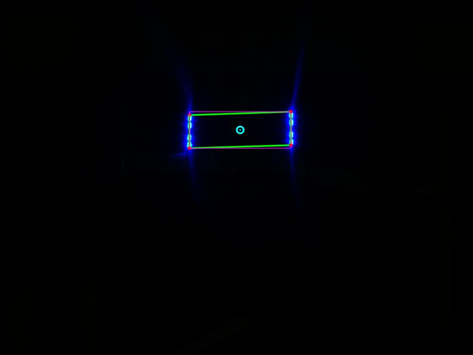

# 1m-after-sampling-view

最终H59、1.00米组采样后可视化画面；带绘图，不作为原始检测或PnP输入。

- 来源：`RDK:/home/sunrise/rdk_pnp_checks/first-group-20261101/live-H59-ref100cm/view.jpg`
- SHA256：`d28774011e01bfd87eabbdab5f182e5464e9f5321068c721295d10737f485013`
- [原照片](../images/1m-after-sampling-view.jpg) · [完整数值JSON](1m-after-sampling-view.json)

这张是带检测绘图的采样后截图，未用它重新检测或PnP；该照片的同步R/Z/XYZ/角点读数未保存，因此这些字段留空。

相关测量组：[1m](../../1m/summary.json)，参考1.00m、约±0.01m，整组50次HTTP抽样平均R=1.001988336m。**整组均值不是这张照片的读数。**

沿用原设备候选内参、W130/H59，验证标志仍为0；重算状态为`debug_unverified`。回放中的时间戳和耗时来自本次回放，不能当作原始拍照时间或实时性能。
