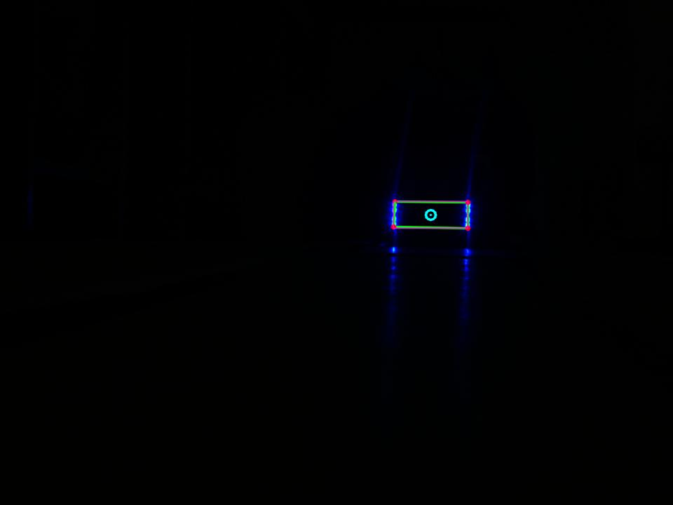

# 2m-after-sampling-view

2.00米组采样后读取的可视化画面；不是逐次采样对应原图。

- 来源：`RDK:/home/sunrise/rdk_pnp_checks/2m-20261102-184551/view-after-sampling.jpg`
- SHA256：`dcfe16c5371675122230114cc627eb67fc682d218a7ea6f189e918c5731105eb`
- [原照片](../images/2m-after-sampling-view.jpg) · [完整数值JSON](2m-after-sampling-view.json)

这张是带检测绘图的采样后截图，未用它重新检测或PnP；该照片的同步R/Z/XYZ/角点读数未保存，因此这些字段留空。

相关测量组：[2m](../../2m/summary.json)，参考2.00m、约±0.01m，整组50次HTTP抽样平均R=1.993074268m。**整组均值不是这张照片的读数。**

沿用原设备候选内参、W130/H59，验证标志仍为0；重算状态为`debug_unverified`。回放中的时间戳和耗时来自本次回放，不能当作原始拍照时间或实时性能。
