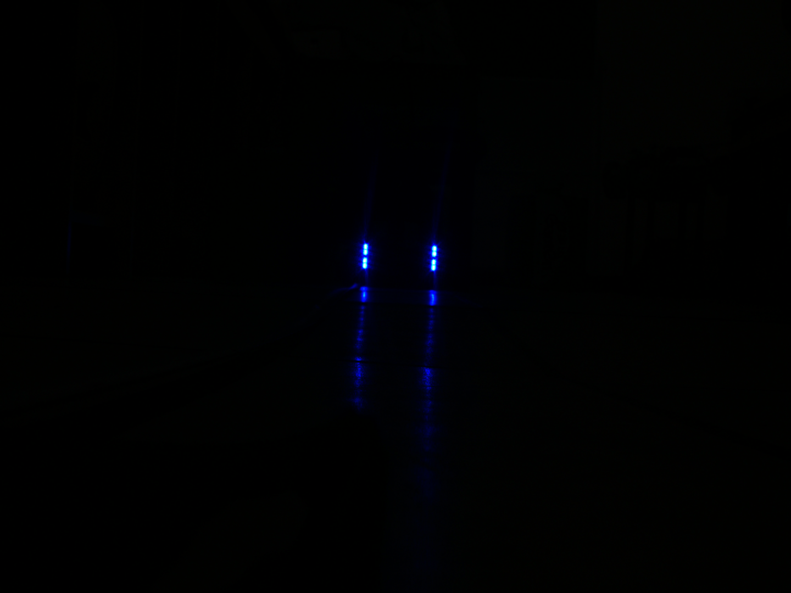

# 2p5m-after-sampling-raw



50次采样窗口结束后单独保存的原图；不是50次读数各自的输入帧。

- 来源：`RDK:/home/sunrise/rdk_pnp_checks/2p5m-20261102-185215/raw-after-sampling.png`
- SHA256：`9b7ae575e71a6220576596ccaf8c9f052679d84645074c8f80216ee0bbcb58eb`
- [原照片](../images/2p5m-after-sampling-raw.png) · [完整数值JSON](2p5m-after-sampling-raw.json)

以下数值由当前C++ ROS 2对本张原图离线重算，不是照片拍摄时保存的同步读数。

| 数值 | 结果 |
|---|---:|
| R直线距离 / m | 2.485244926 |
| Z前向深度 / m | 2.483363963 |
| X / m | -0.008651928 |
| Y / m | -0.096285578 |
| 重投影误差 / px | 0.375848536 |
| 检测装甲数 | 1 |
| 原始图像尺寸 | 1440×1080 |
| 处理图像尺寸 | 960×720 |

四角点为处理图像上的左上、右上、右下、左下，单位px：

```json
[[443.4594421, 295.9330139], [526.8186035, 297.9917297], [525.4556885, 327.9752502], [442.1933899, 325.0519104]]
```

旋转向量（Rodrigues，rad）：`[-0.6362065122, 0.001999094189, 0.03367479192]`。

相关测量组：[2p5m](../../2p5m/summary.json)，参考2.50m、约±0.01m，整组50次HTTP抽样平均R=2.478794547m。**整组均值不是这张照片的读数。**

沿用原设备候选内参、W130/H59，验证标志仍为0；重算状态为`debug_unverified`。回放中的时间戳和耗时来自本次回放，不能当作原始拍照时间或实时性能。
