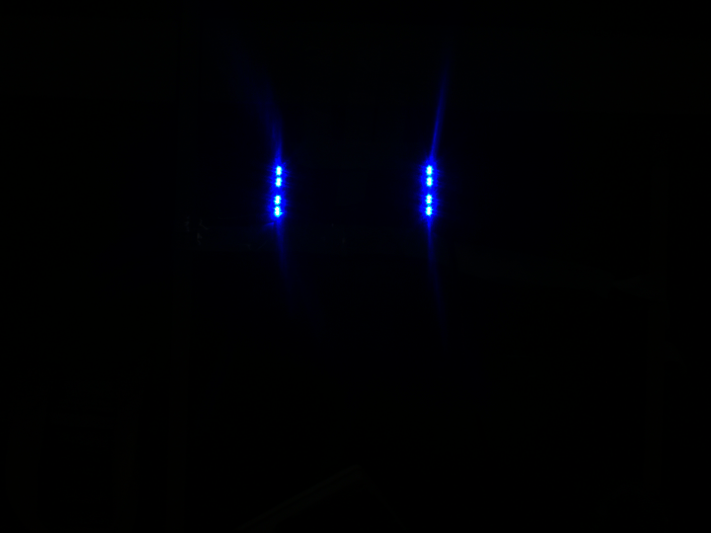

# near-1m-diagnostic-04



约1米附近早期静止诊断原图；在最终1.00米H59测量组之前，不套用最终组参考或均值。

- 来源：`RDK:/home/sunrise/rdk_pnp_checks/stationary-20261101-181849/raw-4.png`
- SHA256：`b3017e1e1c6fc1e384ca63c6f835ccd702f635e2ec7c903f151d1344252826ee`
- [原照片](../images/near-1m-diagnostic-04.png) · [完整数值JSON](near-1m-diagnostic-04.json)

以下数值由当前C++ ROS 2对本张原图离线重算，不是照片拍摄时保存的同步读数。

| 数值 | 结果 |
|---|---:|
| R直线距离 / m | 1.017135416 |
| Z前向深度 / m | 1.014451525 |
| X / m | -0.008290090 |
| Y / m | -0.073374604 |
| 重投影误差 / px | 1.733600410 |
| 检测装甲数 | 1 |
| 原始图像尺寸 | 1440×1080 |
| 处理图像尺寸 | 960×720 |

四角点为处理图像上的左上、右上、右下、左下，单位px：

```json
[[375, 224], [579.8370361, 223.0209656], [578.1380615, 290.9784851], [375, 292]]
```

旋转向量（Rodrigues，rad）：`[0.821765001, -0.02616864891, 0.004873781329]`。

该照片不绑定最终静态测量组，也不以约数场景距离计算精度误差。

沿用原设备候选内参、W130/H59，验证标志仍为0；重算状态为`debug_unverified`。回放中的时间戳和耗时来自本次回放，不能当作原始拍照时间或实时性能。
