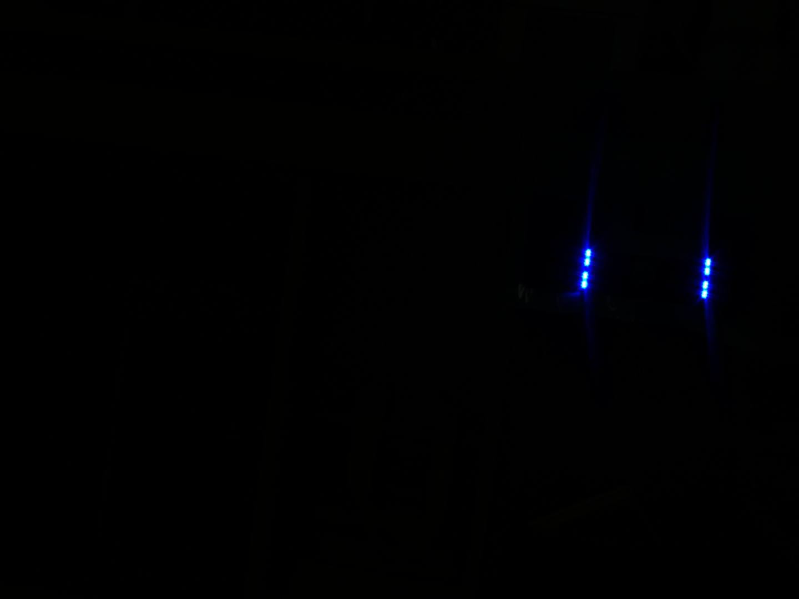

# near-1p5m-diagnostic



1.5米场景的像素过滤诊断原图；关联组仅作背景，未保留该帧同步状态。

- 来源：`RDK:/home/sunrise/rdk_pnp_checks/second-group-20261101/raw-150cm.png`
- SHA256：`20f7c8d1ec91aaa7658cd024ffc3a998d72f54f15149178c78267a085f182721`
- [原照片](../images/near-1p5m-diagnostic.png) · [完整数值JSON](near-1p5m-diagnostic.json)

以下数值由当前C++ ROS 2对本张原图离线重算，不是照片拍摄时保存的同步读数。

| 数值 | 结果 |
|---|---:|
| R直线距离 / m | 1.481333161 |
| Z前向深度 / m | 1.457639356 |
| X / m | 0.260573281 |
| Y / m | -0.041677416 |
| 重投影误差 / px | 0.737473074 |
| 检测装甲数 | 1 |
| 原始图像尺寸 | 1440×1080 |
| 处理图像尺寸 | 960×720 |

四角点为处理图像上的左上、右上、右下、左下，单位px：

```json
[[707.0982666, 299.0131226], [851.0869751, 310.0102234], [845.4487915, 357.9351501], [700.8363037, 345.9782104]]
```

旋转向量（Rodrigues，rad）：`[-0.7022177009, 0.1761285009, 0.1594683739]`。

相关测量组：[1p5m](../../1p5m/summary.json)，参考1.50m、约±0.01m，整组50次HTTP抽样平均R=1.480137621m。**整组均值不是这张照片的读数。**

沿用原设备候选内参、W130/H59，验证标志仍为0；重算状态为`debug_unverified`。回放中的时间戳和耗时来自本次回放，不能当作原始拍照时间或实时性能。
