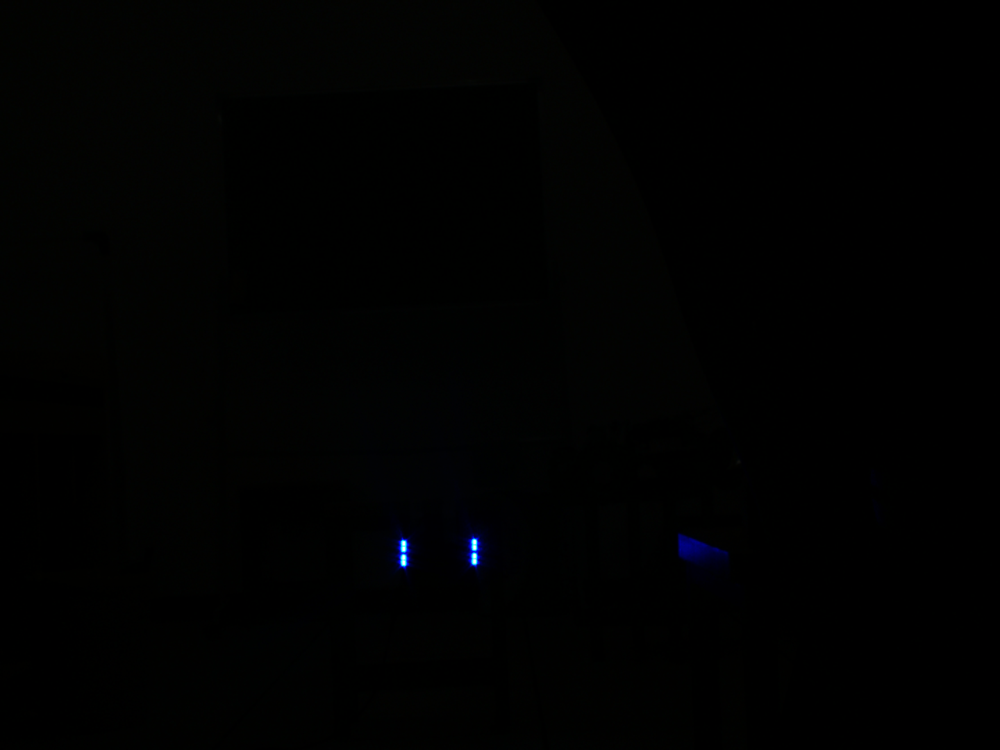

# near-3m-diagnostic-00



约3米检测排查原图，拍摄过程中位置曾变化；不是后续3.10米侧面参考组的同步原图。

- 来源：`RDK:/home/sunrise/rdk_pnp_checks/20261102-172308-3m-diagnosis/raw-0.png`
- SHA256：`4ee78a298732e050f1b4d069faef118dddc00ada802e014ac6b77d433711e21f`
- [原照片](../images/near-3m-diagnostic-00.png) · [完整数值JSON](near-3m-diagnostic-00.json)

以下数值由当前C++ ROS 2对本张原图离线重算，不是照片拍摄时保存的同步读数。

| 数值 | 结果 |
|---|---:|
| R直线距离 / m | 3.059277928 |
| Z前向深度 / m | 3.041815874 |
| X / m | -0.131926959 |
| Y / m | 0.298551357 |
| 重投影误差 / px | 0.297086456 |
| 检测装甲数 | 1 |
| 原始图像尺寸 | 1440×1080 |
| 处理图像尺寸 | 960×720 |

四角点为处理图像上的左上、右上、右下、左下，单位px：

```json
[[387, 518], [455, 517], [455, 541], [387, 543]]
```

旋转向量（Rodrigues，rad）：`[0.5642987987, -0.07319684437, 0.004005716772]`。

该照片不绑定最终静态测量组，也不以约数场景距离计算精度误差。

沿用原设备候选内参、W130/H59，验证标志仍为0；重算状态为`debug_unverified`。回放中的时间戳和耗时来自本次回放，不能当作原始拍照时间或实时性能。
