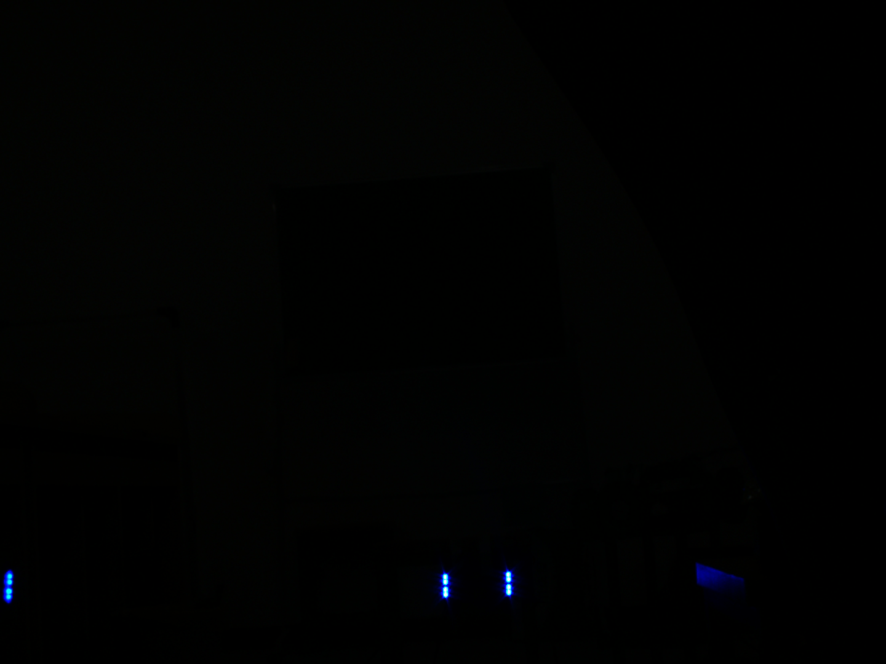

# near-3m-diagnostic-02



约3米检测排查原图，拍摄过程中位置曾变化；不是后续3.10米侧面参考组的同步原图。

- 来源：`RDK:/home/sunrise/rdk_pnp_checks/20261102-172308-3m-diagnosis/raw-2.png`
- SHA256：`82a050aa687b8912eba6c22ea867f9d26a64ab0b5727f9cc4e7b98393d6c5c57`
- [原照片](../images/near-3m-diagnostic-02.png) · [完整数值JSON](near-3m-diagnostic-02.json)

以下数值由当前C++ ROS 2对本张原图离线重算，不是照片拍摄时保存的同步读数。

| 数值 | 结果 |
|---|---:|
| R直线距离 / m | 3.082955870 |
| Z前向深度 / m | 3.042329674 |
| X / m | 0.050163490 |
| Y / m | 0.496317110 |
| 重投影误差 / px | 0.154671836 |
| 检测装甲数 | 1 |
| 原始图像尺寸 | 1440×1080 |
| 处理图像尺寸 | 960×720 |

四角点为处理图像上的左上、右上、右下、左下，单位px：

```json
[[482.5, 622], [550.5, 620], [550.5, 645], [482.5, 647]]
```

旋转向量（Rodrigues，rad）：`[0.4848238476, -0.04070096615, -0.0164721365]`。

该照片不绑定最终静态测量组，也不以约数场景距离计算精度误差。

沿用原设备候选内参、W130/H59，验证标志仍为0；重算状态为`debug_unverified`。回放中的时间戳和耗时来自本次回放，不能当作原始拍照时间或实时性能。
