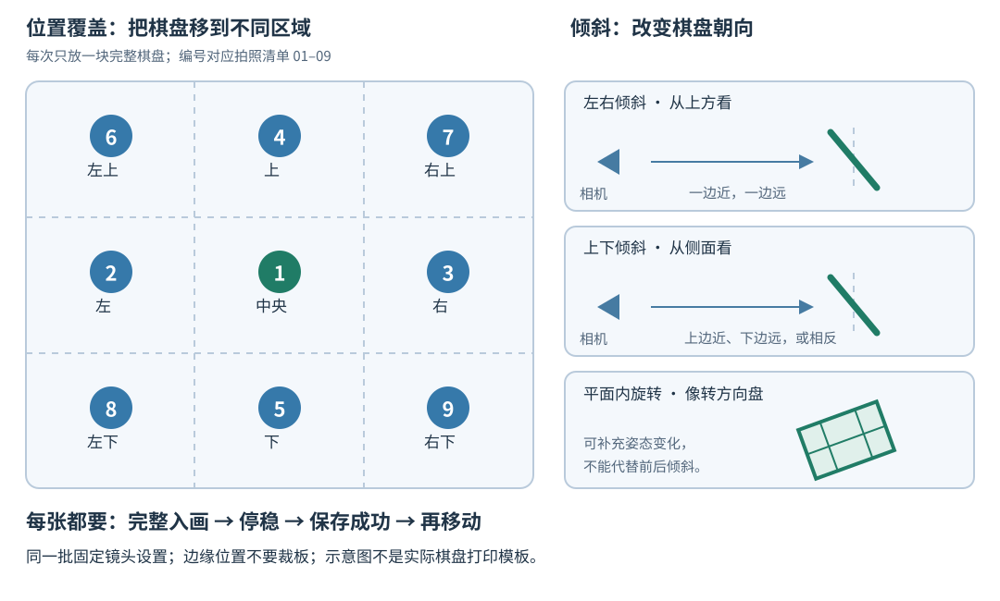

# 棋盘格标定拍照指南

适用流程：海康相机接 RDK S100，在电脑浏览器保存原始照片。更新日期：2026-10-31。

**先确定镜头设置并固定，再移动棋盘拍摄。不同位置、距离和角度是需要的；不同对焦状态不能混成同一组。**

## 1. 先分清：对焦检查、拍标定照、测距核验

| 阶段 | 做什么 | 距离是否必须量准 |
|---|---|---|
| 对焦检查 | 镜头不动，检查近处和主要工作距离是否都清楚 | 大约即可；约 2 米只是本次检查点，并非比赛规定 |
| 拍标定照片 | 同一镜头状态下，采集不同位置、距离、倾角的棋盘照片 | 不必精确量每张的拍摄距离；**格子边长必须实测准确** |
| PnP 测距核验 | 内参算出后，把目标放在已知距离，对比程序读数 | 需要量准距离，并记录从哪里量起 |

当前棋盘是 **9 列 × 6 行内角点，共 54 个角点**，对应 10 列 × 7 行方格。
这张打印板横纵方格已实测为 **19 mm**。文件名中的 `20mm` 是设计尺寸，计算使用实测 19 mm。
更换或重新打印后须重新测量，不能默认仍是 19 mm。

## 2. 拍第一张之前

1. 相机安装稳固；优先固定相机，移动棋盘。拍摄时不要手持晃动相机。
2. 棋盘平整贴在硬板上，无鼓包、折痕；胶带尽量放在边缘，避免覆盖格子产生反光。
3. 使用均匀环境光或补光。关闭或移开正对镜头的蓝色灯条，避免强光和反射干扰。
4. **先完成对焦、焦距和光圈选择，再固定镜头环。** 检查近处及主要工作距离的清晰度。
5. 本批次固定镜头、光圈、ROI 裁剪和采样配置。曝光、增益必要时可以调整，但每张都要清晰、不过曝。
6. 如果采集中又调了对焦或变焦：停止这一批，记录分界，另开新批次；不要把两个状态混算。

只改变亮度不能直接证明内参失效。光圈影响亮度和景深，固定光圈是为了本批条件一致；它不等同于改变焦距。
对焦是否影响有效内参与镜头有关，因此本流程采用“先确定、后固定”的方式减少不确定性。

**如果镜头已经固定，但近处棋盘模糊，不要为了这张照片再拧对焦环。**
应在清晰范围内选择拍摄距离；必要时改善照明、在正式采集前重新确定光圈，或换更大的标定板。
换用方格边长不同的大板时，另开一批、重新实测，不能与 19 mm 的照片直接混用。

## 3. 距离和画面大小怎么选

没有“所有照片必须在 2 米拍”的要求。以**棋盘完整、清晰，而且在画面里足够大**为准。

- 当前 A4 棋盘可先从约 **0.8–1 米**试起；这只是起点，不是强制距离，也不保证都在当前镜头景深内。
- 黑白格区域的宽度，通常可先争取约占画面宽度的 **1/3～1/2**。近处可以更大，但不能裁掉边缘。
- 棋盘靠近画面四角时，可以适当放小，优先保证整块黑白格及周围白边仍在画面内。
- 同一镜头设置下，选近、中、稍远几个**仍然清楚**的位置；不是要求固定拍 1、2、3 米。
- 远处棋盘太小，可以保留作工作距离对焦参考，不必硬塞进内参标定集。

本次约 2 米的试拍虽然找到 54 个角点，但内角点覆盖区域只有画面的约 **1.27%**，边缘也偏软。
它适合作对焦参考，暂不作为正式标定素材。当前筛选脚本的内角点凸包覆盖要求是至少 **3%**；
这是本项目的初版筛选条件，不是通用标定标准，也不是“整张纸占比”。

## 4. 位置与角度怎么摆



**覆盖四角**的意思是让棋盘分别出现在画面左上、右上、左下、右下。
不是让棋盘自己的四个角去顶住画面四个角，更不是裁掉一部分棋盘。
图示仅表达位置；不要为了让中心正好落在某点而把棋盘移出画面。

| 摆法 | 具体动作 | 注意 |
|---|---|---|
| 平移位置 | 把整块棋盘移动到中央、左、右、上、下和四角 | 整块棋盘都能看见 |
| 改变距离 | 整块棋盘靠近或远离相机 | 镜头不动，棋盘仍在清晰范围内 |
| 左右倾斜 | 一侧边缘靠近相机，另一侧远离 | 大约 15–30°可作为起点，不要斜成一条窄线 |
| 上下倾斜 | 上边缘靠近相机、下边缘远离，或反过来 | 同样保持完整格子可见 |
| 平面内旋转 | 像转方向盘一样把棋盘顺时针或逆时针转一点 | 这种旋转不能代替左右、上下倾斜 |

角度用肉眼估计即可，不必拿量角器。清晰、完整、有不同姿态，比凑准某个角度更重要。
不要只拍“正对相机的一张板在画面中平移”；必须包含真正的前后倾斜。

## 5. 推荐拍摄顺序：先拍 3 张检查，再完成约 30 张

下表是**本项目建议的采集清单**，不是赛事规定。每张都要与上一张有明显差别，
不需要为了凑够数量保存模糊照片。先完成 **01、02、03** 后暂停，检查原图质量和大小，再继续。

| 勾选 | 编号 | 棋盘位置和姿态 |
|---|---|---|
| □ | 01 | 中央，中等距离，大致正对相机 |
| □ | 02 | 左侧中部，同一清晰距离 |
| □ | 03 | 右侧中部，同一清晰距离；拍完先检查这三张 |
| □ | 04 | 上方中部，完整入画 |
| □ | 05 | 下方中部，完整入画 |
| □ | 06 | 左上区域，保持白边和整块格子可见 |
| □ | 07 | 右上区域，完整入画 |
| □ | 08 | 左下区域，完整入画 |
| □ | 09 | 右下区域，完整入画 |
| □ | 10 | 中央，较近，棋盘较大但完整清楚 |
| □ | 11 | 中央，中等距离，增加一点倾斜，避免与 01 完全重复 |
| □ | 12 | 中央，稍远，棋盘仍足够大且清楚 |
| □ | 13 | 中央，左边缘向相机靠近，轻度倾斜 |
| □ | 14 | 中央，同一方向增加一点倾斜 |
| □ | 15 | 中央，右边缘向相机靠近，轻度倾斜 |
| □ | 16 | 中央，同一方向增加一点倾斜 |
| □ | 17 | 中央，上边缘向相机靠近，轻度倾斜 |
| □ | 18 | 中央，同一方向增加一点倾斜 |
| □ | 19 | 中央，下边缘向相机靠近，轻度倾斜 |
| □ | 20 | 中央，同一方向增加一点倾斜 |
| □ | 21 | 中央，平面内顺时针转约 10° |
| □ | 22 | 中央，平面内顺时针转约 25° |
| □ | 23 | 中央，平面内逆时针转约 10° |
| □ | 24 | 中央，平面内逆时针转约 25° |
| □ | 25 | 左上区域，加轻度左右倾斜 |
| □ | 26 | 右上区域，加反方向左右倾斜 |
| □ | 27 | 左下区域，加轻度上下倾斜 |
| □ | 28 | 右下区域，加反方向上下倾斜 |
| □ | 29 | 左侧，换一个清晰距离，加一点倾斜 |
| □ | 30 | 右侧，换一个清晰距离，加一点倾斜 |

目标是得到约 **20–30 张质量和覆盖都合适的照片**。拍到 30 张不等于 30 张都会入选；
补拍应针对缺失的位置、角度或清晰度，不是原地连拍补数量。

## 6. 浏览器里怎样保存

1. 打开电脑上的 **<http://127.0.0.1:8876/#debug>**，确认实时画面在线。
2. 摆好棋盘，把相机和棋盘停稳。建议停稳 **1–2 秒**后再点击。
3. 点击一次 **“保存标定照片”**。
4. 等页面明确提示保存成功、数量增加，再移动棋盘拍下一张。
5. 如果提示超时，先检查保存数量，避免连续点击形成重复照片。

保存的是 RDK 上 **1440×1080、未缩放、无检测标记的原始 PNG**。
浏览器 960×720 的显示画面不是原图，不要用截图代替保存按钮。

“未识别到装甲板”不表示棋盘格保存失败。当前网页的识别提示面向装甲，
保存按钮本身也不保证棋盘质量合格；完整角点和清晰度需要后续检查。

当前保存位置在 **RDK**：

```text
/home/sunrise/rdk_blue_vision/calibration/captures/
```

电脑工作目录为 `/home/zhuge/auto/RDK`。旧照片已隔离到：

```text
电脑：/home/zhuge/auto/rdk_calibration_quarantine/20261030-184623/calibration/
RDK ：/home/sunrise/rdk_calibration_quarantine/20261030-184623/calibration/
```

相机检查时额外保存的测试图在 `rdk_camera_checks` 下，不算正式标定照片。
需要重启时，先结束旧相机会话，再在电脑工作目录执行：

```bash
cd /home/zhuge/auto/RDK
EXPOSURE_US=60000 CAMERA_GAIN=16 CAMERA_FPS=15 \
ARMOR_CAPTURE_DIR=/home/sunrise/rdk_blue_vision/calibration/captures \
  bash scripts/run-blue-vision-browser.sh
```

当前 **60000 μs = 60 ms、增益 16、15 FPS** 是室内静态棋盘采集设置。
长曝光容易拖影；优先增加照明，必要时再缩短曝光。不同场地不能直接照搬这组亮度参数。
更改曝光或增益通常不等于改变几何内参，但过曝、噪声和拖影都会影响角点质量。

## 7. 哪些照片需要重拍

| 看到的问题 | 怎么处理 |
|---|---|
| 少了格子、棋盘边缘被画面切掉 | 把棋盘移回画面，或稍微远一点；重新保存 |
| 黑白边缘有拖尾、重影 | 相机与棋盘放稳、补光，必要时缩短曝光 |
| 静止时仍不清楚 | 暂停采集，检查是否在景深内；正式采集期间不要临时拧对焦环 |
| 白格反光发白、黑格也泛白 | 改灯的位置或避开反射，避免透明胶覆盖棋盘 |
| 棋盘很小、只能勉强看见格子 | 靠近到仍清楚的位置，或在另一个新批次使用更大且实测过的标定板 |
| 同一位置、同一姿态连拍很多张 | 保留代表照片，补拍缺失的位置和倾角 |
| 中途调了对焦/变焦 | 停止并另分批次；最终只使用与当前镜头状态一致的一组 |

能找到 54 个角点，只说明“检出了”，不等于“足够清晰”。OpenCV 的棋盘清晰度接口
建议边缘过渡宽度尽量低于约 **3 px**；本项目现有 **6 px** 只是初版宽松筛选线。
当前拍摄应尽量争取更好的质量，不要把通过宽松筛选理解为精度已经验证。

## 8. 拍完以后

告诉我“本批已拍完，期间没有再调镜头”，我会按本批新照片执行：

1. 检查角点、清晰度、亮度、分辨率及画面覆盖，隔离不合格照片，保留原图和原因。
2. 仅用合格目录计算相机内参、畸变和逐张重投影误差，保存新的候选配置与报告。
3. 检查是否仍缺少某些位置、倾角，必要时针对性补拍。
4. 再用实测灯条尺寸和独立已知距离核验 PnP；通过前不把候选配置当成测距已验证。

**照片拍好、内参算出、实际测距核验通过，是三个不同的完成点。**
更详细的筛选命令和 PnP 配置说明见 [CALIBRATION.md](../CALIBRATION.md)。

## 依据

- [OpenCV 标定教程](https://docs.opencv.org/4.11.0/dc/dbb/tutorial_py_calibration.html)：使用不同位置、方向的棋盘照片计算相机参数。
- [OpenCV 棋盘清晰度接口](https://docs.opencv.org/4.5.1/d9/d0c/group__calib3d.html)：边缘过渡宽度与清晰度检查。
- [Basler 图像质量说明](https://docs.baslerweb.com/optimizing-image-quality)：光圈、亮度、景深和曝光拖影的关系。

本文的距离起点、画面占比和 30 张清单是结合当前设备提出的操作建议，不是赛事规定或通用精度保证。
